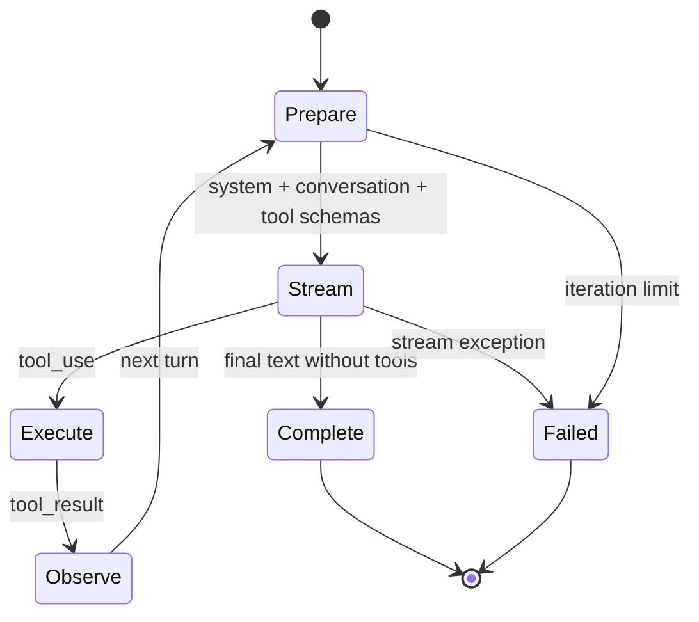

# ReAct Agent Loop

## 1. 核心闭环

MewCode 的 Agent 不是一次模型调用，而是一个“推理/行动/观察”循环。模型输出工具调用，Agent 执行后把结果作为下一轮观察写回 Conversation，直到模型给出不含工具调用的最终回答。

每轮的关键顺序是：

1. 注入环境、长期记忆、Hook 提示和 Plan reminder。
2. 对超大工具结果做预算替换，必要时压缩上下文。
3. 向 LLM 发送 Conversation 与当前工具 Schema。
4. 流式转发文本/思考事件；完整 `tool_use` 一到达就尽早启动无需询问的工具。
5. 将 assistant 的文本与工具调用作为同一条消息写入历史。
6. 收集工具结果，按稳定 `tool_id` 写成一条 user 工具结果消息。
7. 若有工具结果则继续下一轮；若无工具调用则发出 `LoopComplete`。

## 2. 三层状态

| 状态 | 生命周期 | 示例 |
|---|---|---|
| Conversation | 跨轮持久 | user、assistant、tool_use、tool_result、usage anchor |
| 单轮响应 | 一次 LLM stream | 文本、thinking、工具调用、stop reason、token usage |
| 执行任务 | 单轮流期间 | 已提交的异步工具、顺序、结果与耗时 |

分层可以避免把“尚未完整收到的模型响应”提前写进长期历史。流中断时，部分 `StreamText` 可以展示给用户，但不形成一条完整 assistant 消息，也不能留下孤儿工具任务。

## 3. 流式工具执行

`StreamCollector` 把 Provider 事件转换为 Agent 事件并构造 `LLMResponse`。`StreamingExecutor` 在收到完整工具参数后立即创建任务，使工具 I/O 与模型剩余输出重叠；结果收集仍按提交顺序返回，Conversation 则依靠 `tool_id` 建立调用与结果的确定关联。

需要人工确认的工具不能在流期间抢跑，因此先进入 deferred 列表，待响应结束后按顺序产生 `PermissionRequest` 并执行。

## 4. 终止与恢复边界

- **自然完成**：响应没有工具调用，写入最终 assistant 消息并发出 `LoopComplete`。
- **迭代上限**：超过 `max_iterations`，发出 `ErrorEvent`，防止无限循环。
- **连续未知工具**：达到阈值后终止，避免模型反复调用不存在的能力。
- **输出截断**：首次提高输出上限，后续有限次数提示模型续写。
- **外部取消**：保留 `CancelledError`，让任务所有者控制取消语义。
- **流异常**：取消该轮已启动的工具，等待取消完成，发出 `ErrorEvent` 后结束循环。

流异常不能直接穿透到 CLI/TUI，因为 Agent 的公开输出协议是 `AgentEvent`；但也不能吞掉 `CancelledError`，否则上层无法停止任务。

## 5. 测试策略

- 用 Scripted LLM 依次返回“工具调用”和“最终回答”，验证两轮闭环与事件顺序。
- 使用真实 ToolRegistry、Conversation 和参数校验，只 Fake Provider 边界。
- 用会等待的 Slow Tool 制造流中断，验证任务确实收到取消而非仅隐藏异常。
- 同时断言没有 `LoopComplete`，避免失败路径被误报为成功。
- 对多工具场景验证 assistant/tool_result 消息拼接和稳定 ID，而不是依赖完成时序。
