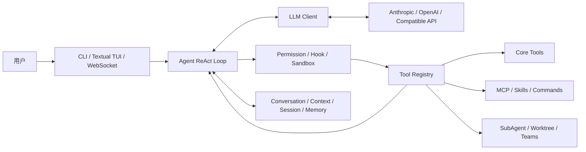

# MewCode Python 架构概览

## 1. 项目定位

MewCode 是一个运行在终端中的 AI Coding Agent。它不只是封装一次模型调用，而是维护持续对话，驱动模型选择工具，执行工具后把结果送回模型，直到任务完成或触发安全边界。

## 2. 核心数据流

一次典型循环包含以下步骤：

1. 入口层接收用户消息并初始化配置、模型客户端与工具注册表。
2. Agent 构造系统提示词，将对话和工具 Schema 发给模型。
3. 模型以流式事件返回文本、思考内容或工具调用。
4. Agent 对工具进行权限判断、参数校验和执行。
5. 工具结果进入 Conversation，必要时触发落盘、压缩或恢复。
6. Agent 继续下一轮，直到模型结束回答或达到终止条件。

## 3. 模块地图

| 责任 | 主要位置 | 作用 |
|---|---|---|
| 进程入口 | `mewcode/__main__.py`、`mewcode/noninteractive.py` | CLI 参数、入口分流、非交互事件到 text/NDJSON 的转换 |
| 交互界面 | `mewcode/app.py`、`mewcode/remote.py` | Textual TUI、WebSocket 服务、权限与计划确认 UI |
| Agent 核心 | `mewcode/agent.py` | ReAct 循环、流式事件、工具调度、恢复与任务通知 |
| 模型适配 | `mewcode/client.py` | Anthropic、OpenAI、OpenAI Compatible 流式协议适配 |
| 对话与提示词 | `mewcode/conversation.py`、`mewcode/prompts.py` | 消息状态、环境注入、系统提示词构建 |
| 工具系统 | `mewcode/tools/` | Tool 抽象、注册表、六个核心工具及高级协作工具 |
| 权限治理 | `mewcode/permissions/`、`mewcode/sandbox/` | 模式矩阵、危险命令、路径规则、OS Sandbox、HITL |
| 上下文治理 | `mewcode/context/` | Token 锚点、工具结果落盘、自动压缩和恢复附件 |
| 外部工具 | `mewcode/mcp/` | MCP 连接、动态参数模型、失败隔离和延迟发现 |
| 长期状态 | `mewcode/memory/`、`mewcode/filehistory/` | 指令、会话、记忆提取、召回、整合与文件快照 |
| 扩展机制 | `mewcode/commands/`、`mewcode/skills/`、`mewcode/hooks/` | Slash Command、Skill、生命周期自动化 |
| 多 Agent | `mewcode/agents/`、`mewcode/worktree/`、`mewcode/teams/` | 子 Agent、后台任务、Git 隔离、邮箱和共享任务 |

## 4. 关键设计原则

- **模型与执行解耦**：模型只生成结构化工具调用，实际能力由 Tool 实现。
- **安全默认拒绝**：权限模式、危险命令、路径沙箱和人工确认共同约束副作用。
- **长对话可恢复**：真实 Token 用量与估算尾部结合，超大工具结果落盘，压缩后保留恢复信息。
- **扩展按需加载**：MCP 和部分高级工具延迟加入 Schema，避免无关工具挤占上下文。
- **并行任务可追踪**：SubAgent、Worktree 和 Teams 分别解决任务拆分、文件隔离与持续协作。

## 5. 已验证的工具执行边界

Day 11 修复了主 Agent 快速执行路径绕过 Hook 的问题。直接、交互式、后台三个入口都在工具执行前运行 `pre_tool_use`，执行后运行 `post_tool_use`；拒绝时不执行工具。Bash 与命令 Hook 的超时和取消会回收其拥有的进程树。具体证据见 [Hook 与跨平台测试](hooks-portability.md)。
