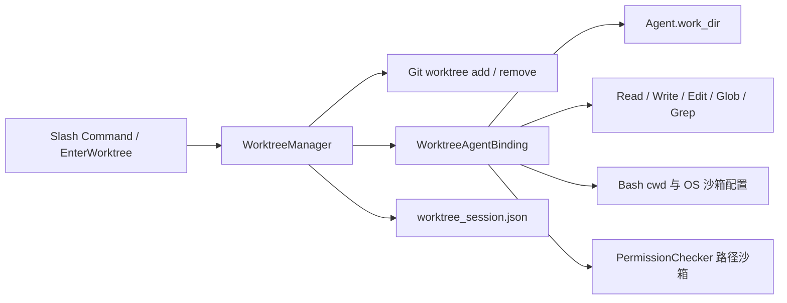

# Git Worktree：执行目录、恢复与安全清理

MewCode 的 Worktree 功能让一个 Git 仓库中的任务使用独立目录和分支。这里描述的是项目自身的 `mewcode/worktree/`，与 Codex 桌面应用提供的工作树管理分别运行。

## 使用入口

```text
/worktree create feature-name [base-branch]
/worktree list
/worktree enter feature-name
/worktree status
/worktree exit
/worktree exit --remove
```

`create` 默认以主仓库的 `HEAD` 为起点，创建并进入新目录；`enter` 进入管理器已经登记的目录。名称中的 `/` 会变成目录名中的 `+`，例如 `team/alice` 对应 `team+alice`；名称不允许路径穿越。默认路径为 `<repo>/.mewcode/worktrees/<name>`，分支为 `worktree-<name>`。

`exit` 保留目录和分支。`exit --remove` 会检查未提交、未跟踪、被 Git 忽略的本地文件以及基线之后的提交，有任何一项即拒绝删除。只有明确选择 `--discard` 才会跳过变更保护；Git 锁和实际删除失败仍会作为错误返回。

模型工具 `EnterWorktree(name)` 与 `ExitWorktree(action="keep" | "remove", discard_changes=...)` 复用同一个管理器。TUI 初始化时把真实 Agent 绑定到管理器，命令入口也会确保绑定。一个会话只进入一个 Worktree；再次进入当前目录保持原会话，进入其它目录前应先退出。

## 调用链与目录约定



进入 Worktree 不调用 `os.chdir()`。每个核心文件工具使用自己的 `work_dir` 解析相对路径；Bash 使用自己的 `cwd`。绝对路径保持原含义，并继续接受权限检查。仅修改提示词或 `agent.work_dir` 无法保证实际文件操作发生在隔离目录。

| 状态 | 进入后的归属 |
|---|---|
| `Agent.work_dir`、六个核心工具执行目录 | Worktree 目录 |
| `PermissionChecker.sandbox.project_root` | Worktree；项目内禁写路径同步映射 |
| 原有外部允许目录、权限规则与模式 | 保留既有配置；它们仍可能允许访问额外目录 |
| Bash OS 沙箱的项目写入/禁写路径 | 映射到 Worktree，外部配置与网络设置保留 |
| `session_dir`、转录文件、长期 Memory | 原会话存储根 |
| FileHistory 备份目录 | 原会话存储根；编辑目标记录为实际绝对路径 |
| Plan 文件缓存 | 切换时清空，后续在当前执行目录重新计算 |

因此，Git Worktree 隔离与权限沙箱是不同的边界。默认临时目录或用户明确配置的额外允许目录仍按原策略生效。文件缓存按绝对路径索引，可以区分两个目录中的同名文件。

Git 的工作树 `.git` 实际指向主仓库的元数据。绑定器只在它指向原仓库 `.git/worktrees` 且 shared `commondir` 与原仓库一致时，把私有 index、共享 objects、分支 refs 和 reflog 目录加入 Bash OS 沙箱的写入路径。共享 refs 是 Git 的共同状态，允许在 Worktree 中提交也意味着 Bash 内的 Git 命令可以改写仓库分支；危险命令仍须经过现有权限策略。Windows 上验证了路径配置，尚未在 macOS/Linux 内核沙箱实际执行提交。

## 恢复与提交保护

`WorktreeManager.enter()` 把原目录、原分支、原 HEAD 和 Worktree 创建基线写到 `<repo>/.mewcode/worktree_session.json`。重启后 `restore_session()` 重新登记当前 Worktree 并恢复执行目录；目录失效时清除这条 Worktree 状态。对话历史的恢复仍通过 Session 功能完成。

创建基线与当前 HEAD 必须分开保存。例如创建时为提交 A，任务提交 B 后重启，删除检查仍应比较 `A..HEAD`。若恢复时把 B 当作基线，检查就会错误地得到零个新增提交。旧版状态文件缺少独立基线时，使用记录中的原始 HEAD 兼容恢复。

已有目录的快速恢复以请求的 `base_branch` 解析结果作为比较点，无法解析时保守保留。新建使用 `git worktree add -b`；若同名分支已经存在则报错，不使用 `-B` 重置分支。

## 清理规则

`count_worktree_changes()` 使用 `git status --porcelain --ignored` 和基线到 HEAD 的提交数量。忽略文件也可能保存用户数据，例如 `.env`。Git 查询失败、空基线和非法基线都不能证明目录干净，因此返回保守的非零标记；这些标记不是精确的文件或提交统计。

`auto_cleanup()` 只清理已登记、无变化且不是当前会话的 Worktree。`cleanup_stale_worktrees()` 进一步限定自动生成的名称、目录修改时间、非当前会话、可读取的 HEAD、无本地文件和无未推送提交。用户命名的普通目录不参与陈旧目录自动清理。

未推送检测查询 `HEAD --not --remotes`，不依赖当前分支的 upstream。没有 upstream 时仍能发现本地独有提交；完全没有远程引用时，陈旧目录会被保守保留。该检查只使用本地远程跟踪引用，不访问网络或自动 fetch。

删除必须同时核对 Git 返回码和目录是否真正消失。Git 拒绝删除锁定目录时，当前会话、分支和管理器记录都保留，清理计数不增加。如果目录已移除但分支因引用锁而删除失败，则返回错误、保留分支，并让 Agent 回到存在的原目录。没有递归删除目录的兜底。

删除前还要核对工作树当前检出的分支与管理器登记的分支一致。若任务在工作树中切到另一个分支，默认删除将拒绝，以免删除目录后强制删掉原分支上不在当前 HEAD 的提交。`ExitWorktree` 的提示使用创建时工作树基线；旧会话状态缺少该字段时才退回原 HEAD。

## 可重复验收

```powershell
& ./.venv/Scripts/python.exe -m pytest `
  tests/test_worktree.py tests/test_worktree_safety.py `
  tests/test_tools.py tests/test_edit_file.py `
  tests/test_permission_boundaries.py tests/test_session_recovery.py `
  tests/test_commands.py -q --basetemp '<dedicated-absolute-temp-directory>'
```

测试使用专用临时 Git 仓库和本地 bare remote，每条 Git 命令仅信任该测试目录；没有全局修改 `safe.directory`。创建、提交、push、工作树锁和引用锁都发生在这些测试仓库中。断言包含 Git 返回码、目录和分支的真实存在状态，以及相对文件写入是否误落主目录。

Day13 最终联合门禁为 **155 passed，退出码 0**。实际验证平台为 Windows；OS 沙箱配置重定位已验证，macOS/Linux 内核沙箱执行未在本日实测。没有使用真实 Provider、远程托管服务；测试 Git 写入只发生在临时测试仓库，不代表全量产品或在线集成验收。
