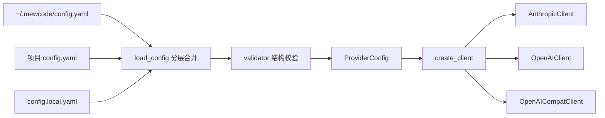

# 配置与 LLM Client 技术概要

## 1. 为什么需要适配层

MewCode 的 Agent 只处理内部 `StreamEvent`，不应该理解各家 SDK 的事件名称、请求字段或异常类型。`mewcode/client.py` 将三种 Provider 协议统一为以下事件：

- `TextDelta`：文本增量。
- `ThinkingDelta` / `ThinkingComplete`：思考或 reasoning 摘要。
- `ToolCallStart` / `ToolCallDelta` / `ToolCallComplete`：结构化工具调用。
- `StreamEnd`：结束原因与 Token 用量。

这样，Agent Loop、TUI 和远程接口可以复用同一套消费逻辑。

## 2. 配置加载链

Provider API Key 的优先级是：

1. `api_key` 配置项中的显式值。
2. 根据协议读取 `ANTHROPIC_API_KEY` 或 `OPENAI_API_KEY`。
3. 两者都不存在时，客户端构造阶段抛出项目统一的 `AuthenticationError`。

`context_window` 和 `max_output_tokens` 也在 `ProviderConfig` 中解析。客户端只消费解析后的值，不直接读取 YAML。

## 3. 三种协议的区别

| 协议 | SDK/API | 主要序列化函数 | 工具格式 |
|---|---|---|---|
| `anthropic` | Anthropic Messages | `build_anthropic_messages()` | `input_schema` |
| `openai` | OpenAI Responses | `build_openai_input()` | Responses function tool |
| `openai-compat` | Chat Completions | `build_chat_completion_messages()` | 嵌套 `function` 对象 |

### Anthropic

- 使用异步 Messages Stream。
- 支持 Thinking、工具参数 JSON 增量和 Prompt Cache 标记。
- 最终 Message 提供 input/output/cache Token 用量。
- 模型元数据查询采用尽力而为策略，失败后回退到本地 context window 映射。

### OpenAI Responses

- System Prompt 通过 `instructions` 传递。
- 对话通过 `input` 传递，工具结果使用 `function_call_output`。
- Day 2 修复后，`ProviderConfig.get_max_output_tokens()` 会进入请求的 `max_output_tokens` 字段。
- `input_tokens` 包含缓存 Token，因此适配层扣除 `cached_tokens`，保持内部计数可加。

### OpenAI Compatible

- 面向 vLLM、Ollama 等 Chat Completions 风格接口。
- 工具调用可能分成多个 chunk，客户端按工具索引累积名称、ID 和参数。
- 部分兼容服务会忽略 `stream_options.include_usage`。Day 2 增加流耗尽兜底，即使没有 usage chunk，也会产生零用量 `StreamEnd`，避免破坏 Agent 的事件结束契约。
- Chat Completions 的 `length` 结束原因会映射为内部 `max_tokens`，从而触发 Agent 既有的截断恢复流程。

## 4. 错误边界

SDK 异常在适配层被转换为项目异常：

| SDK 情况 | 项目异常 |
|---|---|
| API Key 缺失或无效 | `AuthenticationError` |
| 限流 | `RateLimitError`，保留 `retry_after` |
| 连接错误 | `NetworkError` |
| 其他 API 状态错误 | `LLMError` |

上层只依赖项目异常，不需要导入 Anthropic/OpenAI SDK 异常类型。

## 5. SOCKS 代理支持

Anthropic 和 OpenAI SDK 都通过 httpx 读取系统代理。若环境变量包含 `socks5://` 或 `socks5h://`，httpx 需要可选的 `socksio` 包。Day 2 将依赖声明改为 `httpx[socks]`，保证 Provider 客户端可以在此类开发环境中正常构造，同时继续尊重用户代理设置。

## 6. Mock Provider 测试方法

测试保留真实的 `stream()` 适配逻辑，只替换最外层网络对象：

1. Fake Stream 按真实顺序发出 SDK 事件结构。
2. 客户端将事件翻译为内部 `StreamEvent`。
3. 测试断言请求边界字段和完整内部事件序列。
4. 不发送网络请求，也不需要真实 API Key。

这种边界测试能发现字段漏传、结束事件缺失、工具参数拼接错误和 Token 统计错误，而不是只验证 Mock 是否被调用。
