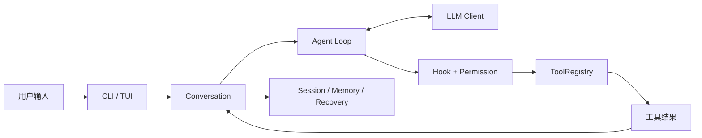

# MewCode 项目讲解稿

这份讲解稿适合用 15–20 分钟向另一位 Python 开发者介绍项目，并沿源码回答“一个 Code Agent 怎样把模型建议变成受控的实际操作”。演示使用 Fake Provider，不需要在线密钥。

## 1. 从一条请求看系统

先打开 `mewcode/__main__.py`：CLI 可以进入 Textual TUI、非交互 `-p` 或 WebSocket 入口。入口读取配置并组装 Client、ToolRegistry、PermissionChecker 和 Agent。核心在 `mewcode/agent.py`：Agent 把 Conversation 与工具 Schema 发给模型，接收流式文本或 ToolCall，经过 Hook、权限、参数校验后调用工具，再把结果放回 Conversation，重复直到模型结束。模型决定“建议调用什么”；Python 代码决定“实际允许并执行什么”。

讲解时可依次看 `mewcode/client.py`、`mewcode/conversation.py`、`mewcode/tools/base.py`、`mewcode/permissions/checker.py`。Provider 流式协议由 Client 适配，工具以统一参数模型和结果协议注册；路径沙箱、危险命令规则和人工确认共同约束副作用。Hook 是独立生命周期扩展，不替代权限判断。

## 2. 为什么长任务能够继续

`mewcode/context/` 在上下文接近窗口限制时压缩历史，将超大工具结果落盘，并把必要文件片段做成 Recovery 附件。`mewcode/memory/` 管长期记忆与磁盘会话；`mewcode/filehistory/` 记录文件改动前的状态。Day 9 测试用两个 Agent 实例和真实 Session 文件验证重启恢复，还验证旧会话的共享工具结果目录不会清掉新会话目录。讲解时强调三个位置：当前执行目录、会话存储根、模型可见上下文，它们在进入 Worktree 后不必相同。

## 3. 扩展与协作的递进关系

Slash Command 把 Markdown 定义装入命令注册表，Skill 可以 inline 或 fork 执行；见 `examples/commands_skills/`。MCP 连接提供外部工具，但本项目目前只用 Fake MCP 验证注册、发现、调用与失败隔离。

SubAgent 把明确的子任务委派给另一个 Agent。前台等待 ToolResult；后台由 TaskManager 管理 runner、Trace、通知和取消。Worktree 解决文件执行目录与 Git 分支隔离，清理前检查忽略文件、本地提交和未发布提交。Teams 在此基础上增加共享任务、按 agent_id 投递的邮箱，以及可继续等待新任务的进程内队友。`examples/subagents/` 和 `examples/teams/` 都可离线复现；后者让 Alice/Bob 分别提交 20/22，并由 lead 合并为 42。

## 4. 如何开发一个新行为

先画真实调用链，找用户入口、状态归属和执行边界。写一个会在旧实现失败的行为测试，例如“pre Hook 拒绝后文件必须不存在”或“切换分支后不能删除原分支提交”。只修改支持该行为的最少源码。先跑定向测试，再跑相邻模块；涉及权限、Git 删除或后台任务时扩大到联合门禁。`git diff --check`、语法检查和最终全量测试用于确认没有遗漏。Fake Provider 用来控制事件顺序；真实临时 Git 仓库用于验证删除和提交；在线 Provider Smoke 必须另用获准凭据，不能把 Mock 结果替代它。

## 5. Git 与 Agent 协作示例

本项目从 `baseline/python-v0.2.0` 起步，Day 9–14 形成连续开发链，每日一个可回退的英文提交，中文日志在 `docs/learning-log/`。当前仓库没有 Git remote，因此不涉及推送、PR 或合并 main。每次提交前先看 `git status --short --branch` 与 `git diff --check`，只暂存明确审阅过的源码、测试和文档；`.mewcode` 真实配置、会话数据及密钥不进入 Git。

项目级 Agent vibe coding 的关键是给 Agent 一条可检验的边界：说明入口、预期行为、不可丢的数据、测试位置和完成门禁。让 Agent 给出失败证据与修复 Diff，由人审阅权限变化、清理行为和测试是否真的覆盖调用链。命令若中断，先查状态；安全幂等验证可重试，Git 等副作用操作应先核对结果再继续。

## 6. 演示顺序与边界

在仓库根运行 `./.venv/Scripts/python.exe -m examples.commands_skills.run_demo --scratch-dir <仓库外目录>`、`./.venv/Scripts/python.exe -m examples.subagents.demo` 和 `./.venv/Scripts/python.exe -m examples.teams.demo`。最后展示 [测试账本](testing.md) 和 [14 天路线图](roadmap.md)。这些演示只证明离线闭环；真实 Provider/MCP 在线 Smoke、macOS/Linux 内核沙箱、终端 pane 后端和多 OS 进程共享任务事务仍需相应环境验证。
